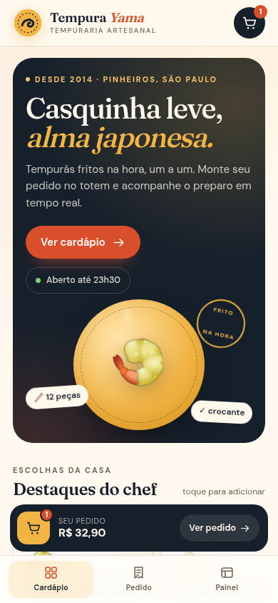
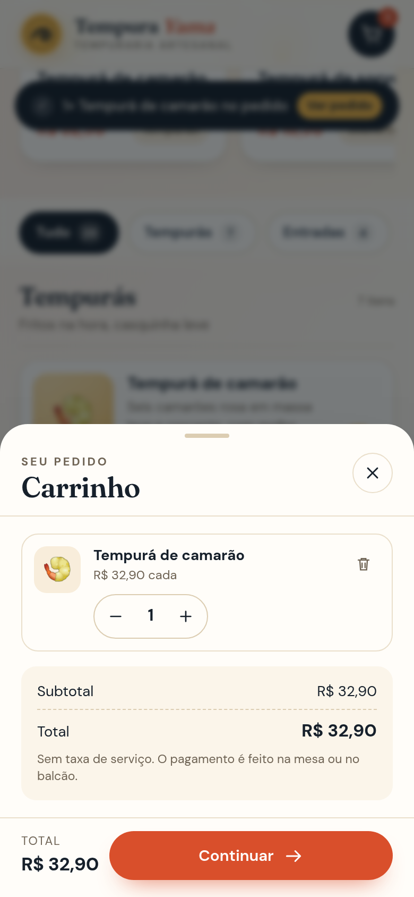
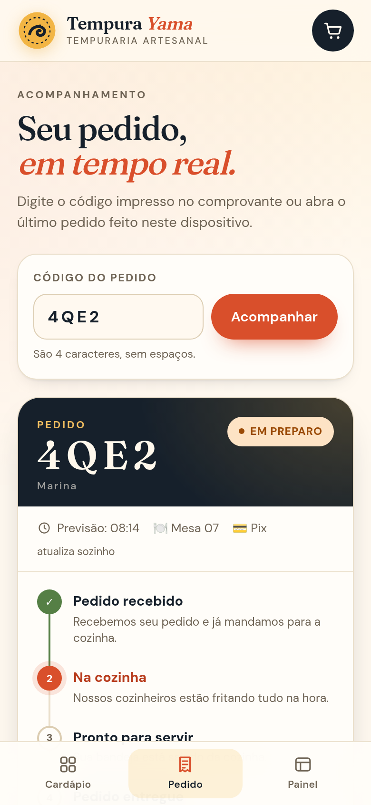
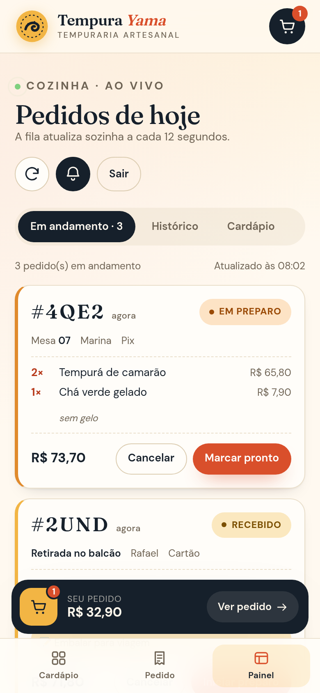

# 🍤 Tempura Yama — Totem PWA de pedidos

Totem de autoatendimento para uma tempuraria artesanal. O cliente navega pelo cardápio,
monta o pedido, informa a mesa e acompanha o preparo em tempo real. A cozinha usa um painel
protegido por PIN para avançar o status dos pedidos e marcar itens esgotados.

O projeto entrega **front-end PWA + back-end + banco de dados + API REST** em um único
serviço Node, pronto para o [Render](https://render.com) com PostgreSQL gerenciado.

| Cardápio (mobile) | Pedido | Acompanhamento | Painel da cozinha |
| --- | --- | --- | --- |
|  |  |  |  |

---

## ✨ Funcionalidades

**Cliente**
- Cardápio com categorias, destaques, preço, tempo de preparo e itens esgotados.
- Detalhe do item com quantidade e observações.
- Carrinho persistente (localStorage), edição de quantidades e checkout em 2 passos.
- Escolha entre mesa e balcão, forma de pagamento e observações do pedido.
- Código curto de pedido (ex.: `7K2M`) e acompanhamento com atualização automática.
- Histórico dos últimos pedidos feitos no dispositivo.
- Layout mobile-first, botões grandes, navegação inferior e suporte a safe area (iPhone).
- Instalação como PWA (Android, iOS e desktop) e funcionamento offline do cardápio.

**Cozinha (admin)**
- Login por PIN (`ADMIN_PIN`).
- Fila de pedidos em tempo real com som de novo pedido.
- Avanço de status: recebido → em preparo → pronto → entregue, além de cancelamento.
- Indicadores do dia: pedidos, faturamento, ticket médio e pedidos em andamento.
- Ranking dos itens mais vendidos.
- Ativação/desativação de itens do cardápio (esgotado).
- Histórico de pedidos finalizados.

**Técnicas**
- API REST validada no servidor (preços e totais nunca vêm do cliente).
- Banco com migração automática de schema e seed idempotente.
- Rate limit nas rotas de pedido e login.
- Cabeçalhos de segurança e CSP.
- PostgreSQL em produção e SQLite no desenvolvimento (mesmo código).
- Testes de integração com `node:test` cobrindo API, banco, PWA e fallback do SPA.

---

## 🧱 Stack

| Camada | Tecnologia |
| --- | --- |
| Front-end | HTML5, CSS3, JavaScript ES Modules (sem framework/bundler) |
| PWA | Web App Manifest, Service Worker, Cache Storage, instalação |
| Back-end | Node.js 22 + Express 4 |
| Banco | PostgreSQL (Render) ou SQLite nativo do Node (`node:sqlite`) |
| Testes | `node:test` + `fetch` |
| Deploy | Render Blueprint (`render.yaml`) + GitHub |

> O front-end é servido pelo próprio Express, então front, API e banco rodam no mesmo
> serviço — simples de publicar e sem problemas de CORS.

### Arquitetura

```
Navegador (PWA instalável)
   │  HTML/CSS/JS + Service Worker (cache do app shell e do cardápio)
   ▼
Express (server.js / src/app.js)
   ├── /            → arquivos estáticos + fallback do SPA
   ├── /api/menu    → cardápio
   ├── /api/orders  → criação e consulta de pedidos
   └── /api/admin/* → painel da cozinha (PIN)
   ▼
src/store.js (regras de negócio)
   ▼
src/db.js → PostgreSQL (DATABASE_URL) ou SQLite (DATA_DIR)
```

### Estrutura de pastas

```
.
├── public/
│   ├── index.html            # app shell (todas as telas)
│   ├── manifest.webmanifest  # identidade e instalação do PWA
│   ├── sw.js                 # service worker (cache/offline)
│   ├── css/styles.css
│   ├── js/app.js             # rotas, cardápio, carrinho, checkout, rastreio
│   ├── js/admin.js           # painel da cozinha
│   ├── js/api.js             # cliente HTTP e utilitários
│   ├── icons/                # ícones 192/512/maskable/apple/favicon
│   ├── fonts/                # fontes locais (funciona offline)
│   └── screenshots/          # screenshots do manifest
├── src/
│   ├── app.js                # rotas e middlewares do Express
│   ├── db.js                 # conexão, schema e seed
│   ├── seed.js               # cardápio inicial
│   └── store.js              # consultas e regras de pedido
├── tests/api.test.js
├── server.js
├── render.yaml
└── package.json
```

---

## 🚀 Rodando localmente

Pré-requisito: **Node.js 22.13 ou superior** (por causa do módulo nativo `node:sqlite`).

```bash
git clone https://github.com/SEU-USUARIO/tempura-yama.git
cd tempura-yama
npm ci
npm start
```

Abra <http://localhost:3000>. O banco SQLite é criado automaticamente em `./data/tempura.db`
e o cardápio é populado no primeiro boot.

Para desenvolver com reload automático:

```bash
npm run dev
```

### Variáveis de ambiente

Copie `.env.example` e ajuste o que precisar (o projeto não usa dotenv; exporte no shell ou
configure no Render).

| Variável | Padrão | Descrição |
| --- | --- | --- |
| `PORT` | `3000` | Porta HTTP (o Render injeta automaticamente). |
| `ADMIN_PIN` | `2468` | PIN do painel da cozinha. **Troque em produção.** |
| `TZ` | `America/Sao_Paulo` | Fuso usado em “pedidos de hoje”. |
| `DATABASE_URL` | — | String do PostgreSQL. Se ausente, usa SQLite. |
| `DATA_DIR` | `./data` | Pasta do arquivo SQLite. |
| `PGSSL` | automático | `disable` ou `require` para forçar SSL no Postgres. |

### Testes

```bash
npm test
```

Os 12 testes cobrem health check, cardápio, criação/consulta de pedidos, validações,
autenticação do painel, transições de status, estatísticas, item esgotado, manifest,
service worker e fallback do SPA. Eles rodam em um SQLite temporário, sem afetar seus dados.

---

## 🔌 API

Base: `/api`. Respostas de erro seguem `{ "error": { "code": "...", "message": "..." } }`.

| Método | Rota | Descrição | Auth |
| --- | --- | --- | --- |
| `GET` | `/health` | Status do serviço e do banco. | — |
| `GET` | `/menu` | Categorias, produtos e destaques. | — |
| `POST` | `/orders` | Cria um pedido e calcula os totais no servidor. | — |
| `GET` | `/orders/:code` | Consulta pública do pedido pelo código. | — |
| `POST` | `/admin/login` | Valida o PIN da equipe. | — |
| `GET` | `/admin/orders?view=active\|history\|all` | Fila da cozinha. | PIN |
| `PATCH` | `/admin/orders/:id/status` | Avança/cancela um pedido. | PIN |
| `GET` | `/admin/products` | Lista o cardápio com disponibilidade. | PIN |
| `PATCH` | `/admin/products/:id` | Marca item como disponível/esgotado. | PIN |
| `GET` | `/admin/stats` | Indicadores do dia e mais vendidos. | PIN |

O PIN é enviado no cabeçalho `x-admin-pin`.

### Exemplo — criar pedido

```bash
curl -X POST http://localhost:3000/api/orders \
  -H 'Content-Type: application/json' \
  -d '{
    "customerName": "Marina",
    "serviceType": "mesa",
    "tableNumber": "7",
    "paymentMethod": "pix",
    "notes": "sem cebolinha",
    "items": [
      { "productId": "tempura-camarao", "quantity": 2 },
      { "productId": "cha-verde", "quantity": 1, "notes": "sem gelo" }
    ]
  }'
```

Resposta (`201`):

```json
{
  "order": {
    "id": "…",
    "code": "7K2M",
    "status": "recebido",
    "totalCents": 7370,
    "items": [{ "name": "Tempurá de camarão", "quantity": 2, "unitPriceCents": 3290 }]
  }
}
```

### Transições de status permitidas

```
recebido → preparando → pronto → entregue
    └──────────┴──────────┴──→ cancelado
```

### Banco de dados

Tabelas: `categories`, `products`, `orders`, `order_items`.
Pedidos guardam **snapshot** de nome e preço dos itens, então mudanças futuras no cardápio não
alteram o histórico. O seed roda em todo boot com `ON CONFLICT DO UPDATE`, mantendo o cardápio
atualizado sem duplicar registros nem sobrescrever a disponibilidade definida pela cozinha.

---

## 📱 PWA

- `manifest.webmanifest` com nome, ícones `any`/`maskable`, tema, atalhos e screenshots.
- Service worker com:
  - pré-cache do app shell (HTML, CSS, JS, fontes e ícones);
  - **network-first** para navegação e `/api/menu`, com fallback para o cache;
  - **stale-while-revalidate** para assets estáticos;
  - nenhum cache para POST/PATCH e demais rotas de API (pedidos sempre vão à rede).
- Cardápio também é espelhado em `localStorage`, garantindo abertura instantânea e uso offline.
- Botão “Instalar app” (quando o navegador oferece o prompt) e instruções para iOS.
- Aviso de nova versão do service worker com ação “Atualizar”.
- Banner de estado offline e mensagens claras em falhas de rede.

Para testar a instalação: abra o site em `localhost` ou em HTTPS, use o menu do Chrome
(“Instalar aplicativo”) ou Safari iOS (Compartilhar → Adicionar à Tela de Início).

---

## ☁️ Publicando no Render (via GitHub)

### 1. Suba o código para o GitHub

```bash
git init
git add .
git commit -m "feat: totem PWA Tempura Yama com API, banco e painel"
git branch -M main
git remote add origin https://github.com/SEU-USUARIO/tempura-yama.git
git push -u origin main
```

### 2. Deploy com Blueprint (recomendado)

1. No [dashboard do Render](https://dashboard.render.com), clique em **New + → Blueprint**.
2. Conecte sua conta do GitHub e selecione o repositório.
3. O Render lê o `render.yaml` e cria:
   - o **Web Service** `tempura-yama` (Node, plano free);
   - o **PostgreSQL** `tempura-db` (plano free);
   - a variável `DATABASE_URL` já conectada ao banco.
4. Clique em **Apply** e aguarde o build (`npm ci` → `npm start`).
5. Acesse a URL `https://tempura-yama.onrender.com` (o nome pode variar).
6. Troque o `ADMIN_PIN` em **Environment** e faça um novo deploy.

O health check usa `GET /api/health`; o schema e o seed são aplicados automaticamente no boot.

### 3. Deploy manual (alternativa)

1. **New + → PostgreSQL** → crie o banco (guarde a *Internal Database URL*).
2. **New + → Web Service** → selecione o repositório.
3. Configuração:
   - Runtime: **Node**
   - Build Command: `npm ci`
   - Start Command: `npm start`
   - Health Check Path: `/api/health`
4. Environment:
   - `NODE_VERSION=22.16.0`
   - `ADMIN_PIN=seu-pin-seguro`
   - `DATABASE_URL=<Internal Database URL>`
   - `TZ=America/Sao_Paulo`
5. **Create Web Service**.

> Sem `DATABASE_URL`, o app sobe com SQLite. No plano free do Render o disco é efêmero:
> os dados são perdidos a cada deploy/restart. Para persistência, use o PostgreSQL do
> Blueprint (ou um disco pago).

### Observações do plano free

- O serviço hiberna após ~15 min sem acesso; a primeira requisição pode levar ~50 s.
- O PostgreSQL free do Render tem validade limitada (atualmente 90 dias) e pode ser renovado
  ou trocado por um plano pago.
- O PIN de demonstração é **2468**; altere antes de divulgar a aplicação.

---

## 🎨 Decisões de usabilidade

- **Mobile first**: layout pensado em 390 px; navegação inferior ao alcance do polegar.
- Alvos de toque com no mínimo ~44 px, botões de avançar pedido grandes para uso na cozinha.
- Tipografia Fraunces + DM Sans embarcadas (sem dependência externa, funcionam offline).
- Contraste alto no tema escuro do herói e nos estados de status.
- `dialog` nativo para foco preso, fechamento com ESC e leitor de tela.
- `aria-live` para carrinho/status, `aria-current` na navegação e `prefers-reduced-motion`.
- Feedback imediato: toast, badge do carrinho, estado “esgotado” e som opcional na cozinha.
- Checkout salva nome/mesa/pagamento no dispositivo para agilizar o próximo pedido.

---

## 🔒 Segurança

- Totais e disponibilidade recalculados no servidor.
- Validação e sanitização de todos os campos; limites de quantidade e tamanho.
- PIN comparado com `crypto.timingSafeEqual` e rate limit no login.
- Rate limit na criação de pedidos.
- CSP restritiva, `X-Frame-Options: DENY`, `nosniff` e política de referência.
- Nenhum dado sensível no front-end além do PIN de sessão (sessionStorage).

> Projeto acadêmico/demonstração: para produção real, use autenticação por usuário, HTTPS
> obrigatório, backups do banco e um PIN forte.

---

## 📄 Licença

MIT. O cardápio, preços e a marca “Tempura Yama” são fictícios e podem ser substituídos.
